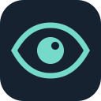

<p align="center"></p>
<h1 align="center">SightGuard · 视界</h1>
<p align="center">看见周围，听见提醒。</p>
<p align="center">Android 环境感知 · 离线中文提醒 · 本地视频分析</p>

SightGuard 通过手机摄像头识别周围目标与环境结构，把需要关注的信息转换为简短的中文提醒。打开应用即可开始感知，无需选择模型或配置语义图层。

[开始使用](docs/guides/getting-started.md) · [Android 构建](android/README.md) · [桌面工具](docs/guides/desktop.md) · [文档中心](docs/README.md)

## 主要功能

- **实时感知** — 连续摄像头预览、检测框与中文类别标签，自动控制辅助模型负载。
- **环境提醒** — 结合目标检测和环境语义，提示墙面、楼梯、杆柱等结构，抑制持续目标的重复播报。
- **中文语音** — 支持动态 TTS；固定提醒提供匹配的离线音频，静音和停止始终可用。
- **描述周围** — 主动获取当前有效的环境概览，当前提醒与最近一次播报分开显示。
- **简洁交互** — 主要操作集中在主界面，研究图层与诊断放入开发者工具。
- **本地分析** — Android 支持本地视频；桌面工具提供视频分析、结果重放与研究工作台。

局部空间候选与候选带用于呈现画面中的地面连续性；它们是实验功能，证据不足时不提示、不绘制，不代表可安全通行。

## 开始使用

**Android 8.0 或更高版本**：安装交付 APK，打开 SightGuard 并授予摄像头权限。保持应用在前台，使用“描述周围”“静音提醒”“停止感知”和“设置”四个主要操作。

当前源码中的 Android 版本为 **0.8.1**。APK 不随 Git 仓库分发；安装方式与交付说明见[使用指南](docs/guides/getting-started.md)和[版本与交付](docs/releases.md)。自行构建请从 [Android 开发指南](android/README.md)开始。

**桌面端**需要 Python 3.12 与 uv，在仓库根目录执行：

```powershell
uv sync --locked
uv run sightguard ui --port 7860 --open-browser
```

网页运行于本机 `http://127.0.0.1:7860`。首次识别前需要准备本地模型，详见[桌面使用指南](docs/guides/desktop.md)。

## 离线与隐私

Android 应用不声明网络权限，摄像头画面与视频在本机处理；桌面服务默认仅监听本机地址。系统 TTS 由设备提供，离线语音包的配置见[语音与隐私说明](docs/guides/privacy.md)。导出的诊断或研究资料可能包含图像与设备信息，请按需保存和分享。

## 使用边界

SightGuard 是盲杖与导盲犬的辅助工具。识别可能遗漏或出错，没有提醒不代表前方没有障碍。当前不提供可靠米制测距、自动导航或安全通行保证。各功能的适用范围见[能力说明](docs/capabilities.md)。

## 项目结构

```text
android/     Android 应用与构建工具
src/         桌面感知、事件、音频和界面
configs/     运行与研究配置
scripts/     数据准备和维护工具
research/    隔离的研究依赖环境
tests/       自动化测试
docs/        使用、开发与历史资料
datasets/    数据说明和可重建的小型样例
```

## 参与项目

开发流程见 [CONTRIBUTING](CONTRIBUTING.md)，版本变化见 [CHANGELOG](CHANGELOG.md)。提交问题时请说明版本、设备和复现步骤，避免上传私人画面。模型与第三方组件的来源和使用条件见[第三方说明](THIRD_PARTY_NOTICES.md)。
