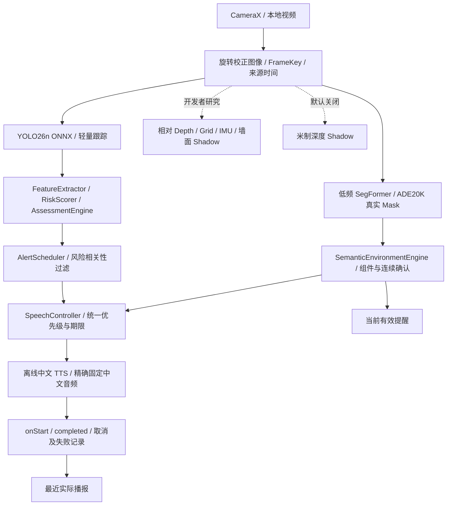
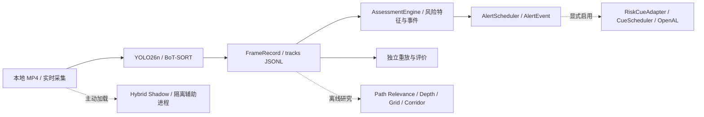

# SightGuard 当前架构

核对日期：2026-10-12，Android 0.4 与独立研究提交 b3d0aeb。这里的“正式链路”表示应用实际使用的规则 / 提醒代码，不表示已通过产品安全验证。能力证据和发布阻塞分别见[状态](product/status.md)与[问题清单](product/known-issues.md)。

## Android 用户链路

`core/` 中的纯 Kotlin 风险核心与 UI、ONNX 对象分离。Android 使用轻量几何跟踪，不是完整 BoT-SORT。CameraX 前台运行，主动停止、后台和模式切换释放会话资源；文件模式与实时相机使用不同 generation / session，旧结果不能跨会话消费。

SegFormer 环境提示与风险分数独立；真实 Mask 的组件、关注区覆盖、支持度、源龄、连续确认、恢复、冷却和事件结束决定提醒。墙面类别存在不自动判为 HIGH。默认支持墙面、楼梯、杆柱、栏杆；STEP 自动提醒关闭。研究 Mask 隐藏时语义策略仍可运行。

主界面由 `AccessibleHome.kt` / `MainActivity.kt` 提供状态、预览和主要操作，开发者工具承载原始模型证据。界面不自行制造空间结论。

## PC 分析与反馈

- `analyze`：MP4 感知、跟踪和记录，不独立播放提醒。
- `replay`：只校验 / 摘要已有感知记录。
- `assess`：复用 tracks 执行原风险和事件核心，输出结构化提醒，不重新推理模型。
- `live`：最新帧槽、独立采集 / 推理、会话规则引擎；PC 音频显式启用。
- `ui`：FastAPI 演示页；`ui --research`：Gradio。网页 MP4 方向演示及手动 NavigationCue 是演示来源，不是安全路径。

PC `risk/decision` 不引用 PyTorch、YOLO 或 UI。模型适配把输出转为可序列化结构，核心只读取当前和历史证据。事件 ID 仅在视频 / 会话内有意义。

## 研究模块隔离

`scene/` 保留相对深度、15×15 图像网格、运动质量和 Corridor 的独立研究契约；严格 D 组在姿态未知时继续 ABSTAIN。

`research/wall_metric.py` 使用真实墙面预测与同帧米制深度统计光轴 Z；`wall_approach.py` 使用特征关联和纯旋转反模型；`local_corridor.py` 复用既有候选算法。它们不回写风险和音频。模型深度分布 P10 / P90 不是准确率区间，CANDIDATE_ONLY 不是 PASSABLE。

Android `MetricDepthDetector` / `WallMetricResearch` 默认关闭，仅开发者可开启；与原 Depth 同次互斥，辅助 worker 串行，不新增相机。关闭开关不加载米制 session，但当前实验包仍包含权重。Android 本轮没有移植 PC 局部 Corridor 评估器。

新增 `metric3d_adapter.py` 和数据集工具只做独立评测；官方 focal 去规范化与坐标恢复不接入正式链路。真实语义 / 深度 / 位姿标签在推理后用于评价，不能输入算法或伪装为相机证据。来源、性能和失败见[公开数据评测](product/dataset-evaluation-20261012.md)。

## 时间、有效性与声音

PC 文件时间优先视频 PTS，不可用时记录 FPS 回退；时间逻辑不使用处理快慢代替视频时间。Android `FrameKey` 区分会话、序号、图像尺寸 / 旋转与时间源。文件模式时间是解码请求位置估计，不保证真实逐帧 PTS。

Camera2 只有声明 REALTIME 且数据有效时，才可将捕获时间与 SensorManager 的时间基准比较；UNKNOWN 不靠任意固定偏移假装同步。设备快速转动可作为独立拒绝信号，不等同精确融合。

环境新语音证据期限为 500ms，包含推理 / 排队耗时；研究显示窗口不延长语音有效期。旧会话、来源不匹配、快速转向或过期结果拒绝新起播。源龄到期与已经开始的一句话是不同生命周期。

`proposed → accepted → onStart → completed` 是不同事实，静音、抢占、过期、TTS / 播放器错误都可中断链路。当前有效提醒与最近播报独立；无声不表示无障碍。

## 数据与复现

`tracks.jsonl` 使用版本 1.0，规则评估产物使用 2.0，独立人工标注与评价使用 3.0；新空间契约另有显式版本。输入、模型、配置、软件、时间来源及失败保留在元数据，冻结协议不能为绕过失败而重写。

模型 / 视频 / APK / 生成输出不提交 Git。旧阶段接口和公式继续见[文档索引](README.md)中的专项文档；2026-10-11 架构审计是历史快照，不代表随后 Android / 空间研究没有实现。
