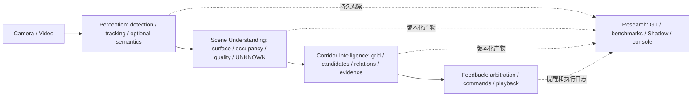

# SightGuard Architecture Consolidation v1

日期：2026-10-11。基于 [实际架构审计](architecture_audit_2026-10-11.md) 与 [Roana固定源码对照](roana_architecture_comparison.md)。本次完成Phase A的审计、边界和文档整理，**未实现Corridor Intelligence**。当前仍是研究原型，无可靠避障、导航或真实碰撞预测证明。

## 1. 目标及当前映射



这是迁移方向图，不是当前实现图；默认YOLO→Risk→Events→AlertEvent在后续阶段继续保留。

- **Perception**：现有YoloPerceptor与BoT-SORT，未来接纳SegFormer适配器及模型状态。只提供画面证据；不持有提醒/播放策略。现有path_relevance.model暂不搬迁。
- **Scene Understanding**：未来统一图像坐标系中的语义surface、bbox占用、相对位置、连续性、相机运动质量及不确定性。Path Relevance可作为已有原型输入，但不等于已实现这个领域；没有测距就不产生meters字段。
- **Corridor Intelligence**：候选网格、候选区域关系及动态证据的评价；既有RiskEngine保留为独立baseline来源。新的候选输出先Shadow，不改变HIGH提醒。
- **Feedback**：由既有decision.alerts提供AlertEvent；spatial负责cue与执行。未来统一来源、命令及执行日志，保留事件状态机。产品DemoGuidance和手动NavigationCue必须携带演示来源，不能伪装为真实风险事件。
- **Research**：evaluation、annotation、console、hybrid、算法对照脚本；可读取核心产物并主动运行实验，但不能被核心Scene/Corridor导入。冻结只限制继续扩张，不删除功能、数据或测试。

## 2. KEEP / CONSOLIDATE / FREEZE / DEFER

每项归类有实际职责依据；CONSOLIDATE在本轮不执行接口变更。

| 处置 | 模块/能力 | 依据与具体动作 |
| --- | --- | --- |
| KEEP | Detection/FrameRecord、YOLO26n/BoT-SORT、MP4/replay/live | 真实调用、独立序列化与会话隔离；保持schema1.0和默认行为 |
| KEEP | Risk features/scorer/AssessmentEngine、EventManager/Health/AlertScheduler | 当前正式结构化提醒来源；保留动态证据与生命周期，作为以后所有实验baseline |
| KEEP | SegFormer/Path Relevance v1 | 已有离线Shadow运行与测试；保留v04权威记录和失败/UNKNOWN，不升格为主决策 |
| KEEP | HRTF/OpenAL、RiskCueAdapter、CueScheduler、AudioWorker | 已有真实可选播放适配；保持方向映射、TTL、仲裁、repeat处理等语义 |
| KEEP | GT3.0、Annotation Studio、A/B/C Benchmark、diagnosis、真实数据来源流程 | 独立评价是差异化基础；未审核标签继续draft，冻结协议不改 |
| KEEP | CLI、产品演示、Research Console、DemoGuidance、手动方向试听 | 有实际入口；通过明确说明保留兼容；DemoGuidance不当作未来导航算法 |
| CONSOLIDATE | 重复文件SHA-256工具与Perceptor process Protocol | 确认相同纯工具职责；未来中性模块实现并从旧路径re-export，测试输出、异常和imports兼容 |
| CONSOLIDATE | 产品/研究共用ConsoleStore中产物I/O与研究功能边界 | 产品加载services触发evaluation imports；先加中性只读artifact adapter，再让旧ConsoleStore委托，保留风险日志验证和路径安全 |
| CONSOLIDATE | Scene上下文/身份/有效性适配、SegmentationOutput类型归属 | 多处frame_id/session_id/video_id命名、mask/图像不可序列化；先旁路adapter，不改已有JSONL |
| CONSOLIDATE | 反馈来源与执行审计 | AlertEvent、DemoSuggestion、NavigationCue、实际播放目前不同来源；未来统一命令来源记录，保留各自算法与旧日志 |
| FREEZE | Laya Structured、Laya Vision、Hybrid fusion | 只保留Shadow选项、隔离环境、推理/超时/TTL测试及历史研究；不得接管AlertEvent/HRTF |
| FREEZE | Experimental Event Association v2 | `allow_class_switch_for_track_id`保持默认false；true只用于显式实验。保留same-ID、class-switch/IoU guard测试与历史对照 |
| DEFER | Metric depth、可靠姿态、真实碰撞时间 | 缺测量与标定证据；不引入新模型、不将相对深度解释成距离 |
| DEFER | 完整实时corridor planning、导航方向、主动绕障、Android | 需空间契约/独立标签/失败验证先行；不在本阶段创建空框架或平台工程 |

Risk Score与Path Relevance并非重复职责：前者处理目标时序风险代理，后者处理目标与语义地面关系。EventManager身份关联与未来Corridor关系也不重复。正式AlertScheduler与声音CueScheduler分别做提醒资格和设备执行，不应合成一个复杂状态机。

## 3. 公共数据契约设计（提案，尚未新增公共类）

优先旁路持久化、从旧数据适配，不修改tracks1.0、risk/events/alerts2.0或GT3.0。建议未来新增命名空间 `sightguard.scene-evidence.v1` / `sightguard.corridor-assessment.v1` / `sightguard.feedback-command.v1`；不是把所有schema_version改成同一数字。实施前需固定样例、校验器和消费者测试。

### 通用观察上下文

每份证据具有：

- `stream_id`：一次视频或摄像头会话的必需身份；`video_id`可空，仅用于数据集映射。禁止将摄像头会话ID当永久身份。离线adapter由manifest/session metadata显式提供，缺失不能猜成另一个视频；旧FrameRecord本身保持原样。
- `frame_index`：保留旧处理帧连续索引；可选 `capture_index`单独表示live采集序号。异步证据另存自己的 `source_frame_index`，不伪造同帧结果。
- `timestamp_ms`和`timestamp_source`：源视频PTS/fps_fallback/live monotonic，会话相对时间。`timebase_id`明确不同流的原点；UTC/predict耗时只能用于审计和执行延迟，不用于替代源时间。
- `observation_id` / `evidence_id`：稳定可追溯引用，可由(stream_id,frame_index,source,detection_index)构造；track_id可空且仅会话内有效。event_id与人工GT event_id命名空间隔离。
- `source`：适配器/模型名、revision、input/config/model hash、来源artifact相对路径+hash+行号/对象索引。大文件hash可放run manifest并引用，不必每帧重复数百字来源信息。
- `model_status`：例如ready/not_enabled/unavailable/failed；`evidence_status`另设valid/partial/unknown/stale。成功推理但空检测与推理失败分开；失效原因列表必需。不要把模型ready等价于场景valid。
- `valid_from_ms` / `expires_at_ms`：同一timebase中的有效区间，采用 `[valid_from, expires_at)`；在now==expiry即stale，不接受未来来源、不同timebase或跨流结果。expiry按证据源配置，聚合有效期不能长于必需输入的最短有效期；历史产物保留但不可作为当前有效证据。

### 最小载荷与现有接口适配

| 契约角色（候选名称） | 最小内容 | 现有来源/兼容方式 | 明确禁止 |
| --- | --- | --- | --- |
| Perception envelope | 观察上下文、旧FrameRecord引用、检测证据、可选semantic引用、各模型status | 包装data.FrameRecord；不向原JSONL加必需字段、不暴露YOLO Results | 用Track ID跨视频证明身份；把未启用semantic当全地面 |
| SceneEvidence | 统一image_normalized坐标、surface候选及mask artifact、object occupancy bbox/足点及method、motion quality、unknown区域/reasons、原观察引用 | SegmentationOutput/Path scene/object rows + Detection→新旁路结果；旧Scene/Path输出继续可读 | ndarray/Torch/Gradio对象入JSON；把bbox面积当真实平方米 |
| CorridorAssessment | 场景evidence refs、grid定义/尺寸/坐标、每格ground/occupied/unknown证据、candidate IDs/区域、object–corridor relations、代价分量/coverage/有效性 | 新实验runner读取相同SceneEvidence；复用Path作为baseline；RiskAssessment作为分立dynamic evidence | 未观测区域默认free；没有depth仍写meters；输出“安全路线” |
| DecisionCandidate | assessment ref、candidate关注项、解释、state/pending、来源模式rule/corridor_shadow、可空risk基线ref | 旁路候选；当前AssessmentEngine→StepResult→AlertEvent保留 | 未验证候选抑制原HIGH；将Path score或Laya score直接覆盖Risk score |
| FeedbackCommand / execution | command_id、source enum、AlertEvent或demo/simulation引用、可空event_id、方向method/reference、priority、TTL、requested channel；单独execution阶段日志 | AlertEvent→RiskCueAdapter→SpatialCue适配；旧SpatialCue1.0与调度行为继续使用 | 有AlertEvent即宣称已听到；将manual导航包装成风险alert |

### 空间与UNKNOWN规则

Scene选用原图归一化坐标（x向右、y向下），保存原尺寸、mask尺寸、resize/letterbox transform和source reference。image grid不是world grid；未来新增depth必须注明relative/metric及单位和校准来源，旧数据不静默变更坐标含义。足点证据保存bbox_bottom_center等method、接地可信度及遮挡限制；不能只保留一个relevance score。

UNKNOWN表示缺少或不足以判断某个属性的证据，**不是LOW、不是0占用、不是可前进**。空检测仍允许surface是unknown；surface valid时单目标接地也可unknown。partial允许部分格/属性有效，分别保存validity，不用总体quality覆盖全部数据。模型失败、不支持类别、低分割质量、异步过期、pose未观测等理由保留；聚合不得降低既有规则风险。原RiskLevel枚举不新增UNKNOWN，以外部evidence状态表达，保持旧消费者兼容。

Motion quality与目标motion_reliable不同：前者描述相机/观察运动是否可信，后者是图像目标变化估计；无IMU/视觉运动估计时明确unavailable/unknown。本轮不实现或假定可靠相机运动补偿。

### 反馈阶段必须分开

`RiskAssessment/DecisionCandidate` → `AlertEvent` → `FeedbackCommand/SpatialCue` → `queued/scheduled` → `submitted` → `backend_reported_playing` → 可选completed/failed/cancelled/expired。

每阶段记录command/alert引用、时间来源和原因。当前AudioWorker records最多512条且在内存，只记录部分提交情况；这不是完整持久播放审计，更不是用户听到的证明。未来执行日志旁路追加，不回改已产生AlertEvent。

## 4. 依赖规则与兼容迁移

1. core data/provenance不导入ML或UI；perception可导入ML，只输出中性证据。
2. scene/corridor只接收可序列化接口及配置，不导入Torch、YOLO、Gradio或evaluation；内部数组如需计算，必须在边界转换成artifact引用或明确JSON载荷。
3. feedback不能调用检测器或通过重新评分补方向；按事件引用找同源观察，缺失则保留方向unknown/现有居中行为。
4. research可调用核心进行显式实验，核心不能导入research；产品服务未来只读中性artifact API，研究功能留在ConsoleStore兼容facade。
5. runtime/pipeline负责编排、会话生命周期、资源和时钟；RiskEngine现在依赖decision是已知历史事实，未来可在编排层适配，不能在本轮声称已解决。
6. 所有新实验默认关闭；开关有schema、显式模式、来源与失败信息。加载模型与选择模式分开，运行状态按实际报告。

迁移顺序：固定当前样例与哈希→新adapter单向生成旁路产物→旧消费者/旧导出路径继续工作→同源运行对照→人工审核/实验门禁→才讨论正式策略接入。不要搬src以获得表面整齐。

冻结协议特别约束：`evaluation.protocol.code_fingerprint()`覆盖**全部**src/sightguard Python。CLI help或纯工具变更也改变fingerprint，不能自动重封旧protocol或弱化检查。未来改变代码时保留旧提交/旧protocol作baseline，新实验使用新的显式protocol；是否缩小指纹范围要单独研究审查。旧源码兼容与旧冻结证据兼容是不同概念。

## 5. 分阶段可执行路线

### Phase A — Architecture Consolidation（本轮）

- 输入：HEAD1af1f70的源码/配置/测试/本地研究产物，Roana固定提交；输出：实际审计、比较、契约提案、入口状态与迁移门禁文档。
- 可改模块：本轮只修改README/docs；原计划CLI help修正因全src冻结指纹而延期。
- 不改：所有运行代码、配置、Schemas、uv.lock、AGENTS.md、研究输入/输出和既有测试。
- 兼容：源字节与全部配置一致；旧日志逐条重放；历史记录保留，最新状态放入口索引而非删除历史。
- 验收：主/Shadow/研究/演示来源均可从源码定位；Ruff/pytest/UI smoke通过；旧文件哈希不变；没有空Corridor类或新模型。
- 回滚：只对本轮文档提交做revert（用户授权后）；运行代码无需回滚。不reset或清理其他成果。

### Phase B — Corridor Intelligence v1（下一阶段，需新任务授权）

- 输入：固定tracks1.0、原视频同源SegFormer证据、metadata/配置；输出：SceneEvidence与CorridorAssessment旁路日志、候选image grid、relations、coverage/unknown与代价解释。无导航命令、无实际播放。
- 接受修改：新增中性scene/contracts adapter、实验corridor实现与runner；path_relevance数据类型可加兼容导出；evaluation新增独立空间标注/比较工具。每次仅一个可验收变化。
- 不改：YOLO/BoT-SORT、Risk阈值/评分、EventManager/AlertScheduler、Spatial调度与HRTF、GT3.0和已冻结Benchmark。
- 兼容：旧输入/输出仍能直接读取，实验新schema，新输出目录；继续旧Risk/Path baseline，新protocol不覆盖旧protocol。
- 验收：同源坐标/ID/时间可追溯；空检测、missing model、低质量、边界坐标、过期/未来/跨流证据均有测试；unknown格不能变成free；排序确定；真实空间关系由独立人工标注评估。未完成标注前只报告coverage/一致性/性能，不宣称准确率或安全收益。
- 回滚：停止实验runner/禁用新adapter；旧tracks与Rule主链路继续可用；删除新组件需在单独提交范围内revert，不删研究记录。

### Phase C — Dynamic Decision

- 输入：同源CorridorAssessment、旧RiskFeatures/RiskAssessment、目标生命周期、可选相机运动质量；输出：可解释dynamic evidence/候选优先级及独立稳定状态Shadow。
- 接受修改：corridor候选稳定器、motion-quality来源适配和中性编排；研究对照新增规则/Corridor组合。
- 不改：旧RiskEngine baseline、Event身份/生命周期、AlertEvent2.0与默认正式调度、冻结A/B/C算法和GT、音频。
- 兼容：双流并行，旧引擎与新候选分别记录，源引用一致；相机质量未观测则unknown；新策略和协议单独命名。
- 验收：运动不可靠、时间跳变、ID切换、多目标、候选消失/恢复及session隔离测试；候选频率变化不破坏基于timestamp的稳定性；独立事件/机会标注评估重复和遗漏；默认风险日志仍等于baseline。
- 回滚：关闭dynamic Shadow，继续旧Rule输出；不改写历史事件或自动重封协议。

### Phase D — Feedback Consolidation

- 输入：正式AlertEvent、经过门禁的候选信息、演示/模拟来源、SpatialCue；输出：统一source-aware反馈命令与持久执行日志，明确unknown/降级提示。
- 接受修改：反馈adapter、来源/内容聚合、执行日志、UI只读状态；先保持既有CueScheduler/OpenAL行为，再独立实验任何调度变化。
- 不改：风险评分/事件身份、模型、输入Schemas、HRTF方向转换/后端语义；未经验证Corridor不能抑制旧HIGH。
- 兼容：AlertEvent2.0与SpatialCue1.0旧路径仍可运行；新执行日志是旁路，浏览器Demo与PC风险音频显式区分，手动Navigation保留simulation标签。
- 验收：风险候选/提醒/排队/实际提交可逐阶段追溯；过期/静音/抢占/取消/失败/unknown日志与行为一致；历史HRTF与方向单元测试通过；新增渠道需独立设备验证，感知可在音频失败时继续。
- 回滚：关闭新聚合/审计adapter回到旧cue路径；保留新日志作为研究材料，不重写旧提醒。

## 6. 下一阶段最优先的三个接口/组件

1. **ObservationContext + SceneEvidence兼容adapter**：先包裹FrameRecord和Path场景，明确流/时间/坐标/来源/各源有效性；无推理、无决策副作用。
2. **ImageSpatialGrid / CandidateCorridor evaluator（Shadow）**：只用现有YOLO+SegFormer证据，保留ground/occupied/unknown分量与候选代价，不输出动作建议。
3. **ObjectCorridorRelation + dynamic evidence接口**：用detection_index/track/event引用关联候选，保留接地/遮挡/运动可靠性、Risk baseline和TTL；先评估可复现关系，再进入Phase C稳定器。

## 本轮交付与验收记录

实际工程选择是文档整合，没有新增运行代码或修改公开接口。理由：最确定的问题是入口/阶段/默认设备说明相互矛盾；改源代码会触及全src冻结证据，当前没有必要承担该变化。

本轮修改：新增三份架构交付文档；README增加真实入口/主链路/Shadow状态索引、校正辅助模型设备及历史验证说明；docs/architecture.md标明当前阶段、修复evaluation/ui仍“未实现”的旧句，补充产品与Path边界。历史实验记录未删除。

最终验收：

- Ruff lint通过，Ruff format check通过，`git diff --check`通过。
- 默认完整pytest前后均 **371 passed、6 skipped**（23.29s / 23.30s）；6项是原有显式模型集成测试。完整套件涵盖schema、risk/events、live隔离/过期、Path/Hybrid Shadow、产品/研究UI和空间音频模拟验证；未运行真实模型、摄像头或耳机测试。
- CLI `--help`、`--version`、`ui --help`、`live --help`、`path-relevance --help`、实际tracks `replay`退出码均0。CLI路由代码保持原字节，产品/研究的实际入口未变化。
- 现有项目根目录Research Console通过 `launch_ui(..., prevent_thread_lock=True)`启动，localhost HTTP200并正常关闭；产品FastAPI TestClient验证首页、状态接口HTTP200，live未启动。首次smoke辅助脚本误把返回的ASGI App当成Blocks关闭而失败，修正为 `get_blocks().close()` 后重试通过；未修改应用代码。
- 221个原有跟踪文件中仅README.md和docs/architecture.md改变；所有src、scripts、tests、configs、Schemas、pyproject.toml、uv.lock、AGENTS.md字节不变。148个既有研究产物哈希一致，包括phase3_final、UrbanEgo baseline和Path v04。
- 无模型重放八段真实tracks：2,400帧，257条提醒；risk_frames/events/alerts均与历史逐条相等。它证明默认结果兼容，不证明风险判断正确。
- 历史phase3_final源码指纹与当前HEAD的6份旧文件/47份新增文件差异是预先存在的，未改旧protocol或实验结果；未来复现必须使用相应冻结版本，不自动放宽检查。

本地详细输出：`outputs/architecture_consolidation/2026-10-11/{baseline.json,artifact_baseline.json,source_inventory.json,baseline_replay.json,verification.json,pytest-final.log,pytest-final.xml}`。pytest的最终basetemp与TEMP/TMP均位于D盘，本轮生成产物不纳入Git。

可复核检查命令（使用已安装环境，不触发下载）：

```powershell
.venv/Scripts/python.exe -m ruff check .
.venv/Scripts/python.exe -m ruff format --check .
.venv/Scripts/python.exe -m pytest -q -ra --basetemp outputs/architecture_consolidation/recheck-tmp
.venv/Scripts/python.exe -m sightguard --help
.venv/Scripts/python.exe -m sightguard replay --input outputs/real_world/v01/urbanego_run8_01/perception/tracks.jsonl
git diff --check
```

复核时使用新的测试临时目录，避免覆盖其他运行。完整基线哈希与逐视频重放计数见审计文档和本地JSON。本轮不开展摄像头、耳机、模型或道路验证，不自动进入Phase B，不自动push。Roana临时源码检出触发LFS及清除被拒绝的情况见对照文档，残留未进入项目提交。
