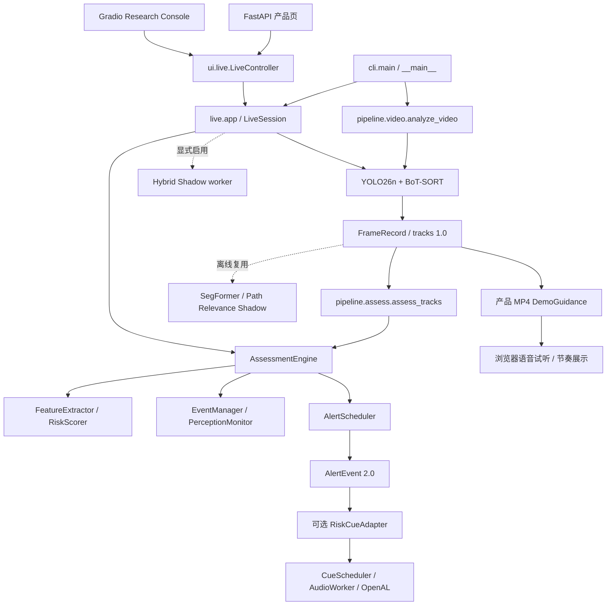

> 历史资料：保留当时的实现与验证记录。当前使用入口见仓库 README；本文不是当前能力清单。

# SightGuard 架构审计 · 2026-10-11

本报告描述本地代码的实际调用关系。目标 Corridor 架构见 [整理计划](../research/architecture_consolidation_plan.md)，外部实现见 [Roana 对照](../research/roana_architecture_comparison.md)。源码位置以本次基线 HEAD 为准；下文以文件和符号定位，避免后续文档编辑改变行号。

## 1. 保护状态与基线

- 起点：`codex/annotation-studio`，HEAD `1af1f7030d828d5d29a6160702960d228878242f`。`git status --short` 为空；没有已暂存、未提交或非忽略的未跟踪文件。
- 远程：`https://github.com/miociallo0721/SightGuard.git`。通过 `git ls-remote --symref origin HEAD` 核实默认分支为 master，远程 HEAD 为 `757468ec4ef5eb4dea23fbd129e0971d87dee28a`，与本地 origin/master 一致。`git rev-list --left-right --count origin/master...HEAD` 为 `0 11`；本地成果不能从 master 还原。
- Algorithm Refinement：`bf75e7386e0c3b4b57b29b4278ea0a37795c3ba4`；Path Relevance：`3902563c458832839bbf1d143612a934ecb53c34`；后续研究报告在 `6b90ede`、`1af1f70`。未合并或切回旧 master。
- 本轮从当前 HEAD 创建 `codex/architecture-consolidation-v1`，未移动或删除其他分支，未修改 AGENTS.md，未 push。
- `docs/` 研究文档均已跟踪。另有被忽略的 `outputs/hybrid/gpu-benchmark/*/report.md`（CPU、CUDA、matched 等批次）和 `outputs/phase3_{final,check,development,repeat,c_only}/report.md`。保留原地，未擅自纳入提交；模型目录的上游文档不作为 SightGuard 研究成果提交。
- 基线保存在 D 盘 `outputs/architecture_consolidation/2026-10-11/`：`baseline.json` 保存原有 221 个跟踪文件 SHA-256、Python/包版本；`source_inventory.json` 保存 AST imports/类/函数位置；`artifact_baseline.json` 保存 148 个现有日志、配置证据、报告文件哈希；`baseline_replay.json` 保存真实 tracks 的无模型重放对照。上述生成输出保持 Git 忽略。
- 本机 `.venv`：Python 3.12.15、Ultralytics 8.4.174、Torch 2.14.1、NumPy 2.5.3、OpenCV 4.14.0.94、Gradio 6.30.0、pytest 9.1.1、Ruff 0.16.10、PyYAML 6.0.3。模型隔离研究环境另有版本，不能将其 CUDA 结果归于主 `.venv`。
- 可跨机器复核的关键SHA-256：`uv.lock`=`f01e4da7f004d035563008082d9dd5ac9bbb9f06bd4545ab93aa12aa9e9affb0`；`configs/risk.yaml`=`d482871268e2f1e6c4e8fdee8412adaf94058c1e14aa9af037def69e0709daf7`。完整来源可从上述基线HEAD还原，本轮不改依赖或风险配置。

AGENTS.md 的“当前只实施 Phase 1”与当前已有 Phase 2–5 源码存在历史范围差异。本轮按用户明确授权审计现有阶段，保留该文件，不自行修改项目规则。

## 2. 真实核心与入口

正式提醒在这里指现有规则链路产生的结构化 AlertEvent，不表示产品已经过道路或使用者可靠性验证。

### 入口逐项核实

| 入口 / 源码符号 | 实际调用与模型 | 输出、独立性与正式提醒 | 初始化 / 重复推理判断 |
| --- | --- | --- | --- |
| `sightguard analyze`；`cli.main`、`pipeline/video.py:analyze_video` | 一个 YoloPerceptor；本地 YOLO26n，`model.track(persist=True)` 使用 BoT-SORT | tracks.jsonl、annotated.mp4、run_metadata.json；独立 MP4 感知，不产生 AlertEvent | 每个视频独立模型/跟踪状态；不加载 SegFormer/Laya |
| `replay`；`data.py:replay_records` | 标准库读取 tracks | 校验连续帧/时间与摘要；独立运行，无模型、无正式提醒 | 不重新推理 |
| `assess`；`pipeline/assess.py:assess_tracks` | AssessmentEngine，无 ML 依赖 | risk_frames/events/alerts JSONL 和 metadata；正式规则 AlertEvent；独立于原视频 | 每次新建会话；EOF 写 censored changes，非新提醒 |
| `live`；`live/app.py:run_live`、`live/runtime.py:LiveSession` | 单个 YoloPerceptor + 单个 AssessmentEngine；音频仅 `--spatial-audio` 启用 | OpenCV 窗口、终端提醒、内存 LiveResult；默认不持续保存 tracks。正式规则提醒 | capture/inference 各一线程，容量一最新帧槽；处理编号连续，采集编号可跳帧 |
| 默认 `ui`；`ui/product_app.py:build_product_app`、`launch_product_ui` | FastAPI 静态产品页；live API 复用 LiveController；上传用 AnalysisJobs | localhost 产品页面、jobs JSON/ZIP、MP4 回放；上传保存正式风险日志，页面 suggestion 使用 DemoGuidance | 页面构建不加载模型；一次上传任务单模型；实时与离线任务没有统一推理资源租约 |
| `ui --research`；`ui/app.py:build_app`、`launch_ui` | Gradio；ConsoleStore、AnalysisJobs、LiveController、标注、对照、空间试听、Path Relevance 产物浏览 | 研究查看/主动任务/标注/导出。实时仍用正式核心；策略预览和诊断是研究结果 | 构建页面不加载模型；显式上传分析才推理；策略预览只重放 tracks |
| `benchmark` / `validate-labels` / `seal-labels` / `freeze-protocol` / `import-video` | evaluation 的 runner/dataset/importing/protocol；benchmark 用 run_strategies | GT 3.0、协议与 A/B/C 提醒、匹配、指标；不是实际音频入口 | A/B/C 共用一次 Phase 2 评估；A/B 独立基线策略不是重复模型 |
| `path-relevance`；`path_relevance/pipeline.py:run_path_relevance_batch` | SegformerB0Perceptor，MiT-B0/ADE20K；复用原视频和已有 tracks/risk/alerts | 场景、目标相关性、shadow、overlay、A/B/C/D 研究建议；独立离线，无正式提醒/音频控制 | 采样推理，批次复用分割模型；不重跑 YOLO；本命令默认输出 v01，最新权威报告是 v04，不能按默认路径认定最新 |
| Hybrid Shadow；`LiveSession.enable_intelligence`、`hybrid/manager.py:IntelligenceManager` | 显式 UI select/load；隔离解释器，Structured ONNX 或 Vision PyTorch，单辅助进程 | decisions/comparisons/errors、采样规则来源、模型元数据；mode=hybrid 也是 Shadow | 容量一输入、限频、取消 generation、TTL/关联检查；不重建 YOLO、摄像头或 RiskEngine |
| GPU/Shadow runner；`scripts/verify_laya_{structured,vision}.py`、`verify_hybrid_live.py`、`benchmark_hybrid_{gpu,pipeline}.py`、`investigate_vision_unknown.py` | 本地显式模型与设备研究；pipeline 使用 PacedVideoCapture + LiveSession | 模型/性能/同源判断日志；独立脚本，不是默认 CLI 分支 | 不同研究阶段有意新建独立会话；RuleDecisionProvider 读取已有 decision，不再运行核心 |
| 真实数据/算法研究；`scripts/run_real_world.py`、`compare_event_association.py`、`diagnose_alert_behavior.py` | 前者显式跑 analyze/assess/draft；后两者复用 tracks/日志 | batch/draft、v1/v2 对照、行为诊断；没有已审核真值就不输出真实监督效果 | 数据准备脚本可下载内容，但本轮未运行；诊断不推理新模型 |
| `spatial-demo`；`spatial/app.py` → `ui/spatial_lab.py` | Gradio + AudioWorker + OpenAL Soft，无视觉模型 | 手动试听/方向模拟、后端状态；独立，不产生正式 AlertEvent | 全进程音频设备 lease；Lab/Live 使用同一个后端家族 |

### 关键问题的代码答案

1. **SegFormer 不在实时默认链路。** `LiveSession._infer` 只调用 perceptor.process 与 engine.step。UI Path Relevance 页只读产物。
2. **Path Relevance 当前仅离线 Shadow。** 配置 `production_decision_changed: false`，CLI 显式拒绝非 false；场景语义地面连通块不是完整空间网格或安全走廊。
3. **Event Association v2 默认关闭。** 实际开关名称是 `AssociationConfig.allow_class_switch_for_track_id=False`，不是一个泛化的 v2_enabled。`configs/risk-association-v2.yaml` 显式 true；比较脚本要求它只与 baseline 相差这个开关。同 ID 跨类仍必须过 overlap guard。
4. **Laya、Vision、Hybrid 仍是 Shadow。** `_infer` 的正式音频/AlertEvent 提交先完成，再 submit 给 IntelligenceManager；后者没有向 AlertScheduler/AudioWorker 回写候选的路径。默认不创建 manager 或加载辅助模型；模式选项不等于控制权切换。
5. **AlertScheduler 最终创建规则 AlertEvent。** AssessmentEngine 协调评分、事件和健康监测；RiskScorer 本身不播放音频、不创建提醒。
6. **实际 PC 音频由 AudioWorker / CueScheduler / OpenALBackend 控制。** RiskCueAdapter 只映射 first、escalation、perception_limited，不映射 repeat。方向缺失可居中，过期 cue 不提交；即使存在 AlertEvent，也可能静音、过期、未排队、后端失败。
7. **存在独立的反馈语义。** `DemoGuidance.step` 只用检测框和视频时间产生 left/right/forward/stop/unknown，产品 MP4 `prepare` 将其放入 suggestion；`ui/web/app.js` 的浏览器 speechSynthesis 试听读取 suggestion.speech。它不经过正式 AlertScheduler。手动 NavigationCue 也不产生 AlertEvent，但与真实风险 cue 共用音频队列。A/B 基线、Hybrid 候选、Path Shadow 各自判断是研究对照，不应混作第二套正式提醒。

## 3. 模块审计表

所有位置均相对 `src/sightguard/`。Action 为本次架构处置结论；整合项本轮只给迁移方案。

| Module | Location | Purpose | Inputs | Outputs | Dependencies | Runtime | Status | Problems（已确认） | Action |
| --- | --- | --- | --- | --- | --- | --- | --- | --- | --- |
| CLI/config | cli.py、config.py | 命令路由、感知配置 | argv/YAML | 调用/配置 | argparse、各分支延迟导入 | 两者 | 主入口 | ui help 称 Research，但默认 FastAPI 产品页 | KEEP；说明修正，代码迁移待后续 |
| Perception record | data.py | 序列化、replay | 检测/JSONL | Detection、FrameRecord 1.0 | 标准库 | 两者 | 核心 | 帧中无 stream_id/model状态/TTL；由会话上下文补充 | KEEP |
| Detection/tracking | perception/yolo.py | YOLO/BoT-SORT、转换 tensor | BGR/配置 | Detection tuple | Ultralytics、NumPy | 两者 | 主链路 | 无独立 Track 公共类；ID 是会话估计 | KEEP |
| MP4 pipeline | pipeline/video.py | 解码/PTS/资源/产物来源 | MP4/感知配置 | tracks、视频、metadata | OpenCV、perception、visualization | 离线 | 主链路 | CFR 预览不代表 VFR 原时间；hash helper 重复 | KEEP |
| Assessment replay | pipeline/assess.py | 无模型风险重放 | tracks/RiskConfig/stream_id | risk/events/alerts/metadata | data、risk | 离线 | 主链路 | 默认 stream_id 为绝对路径哈希，可移动性不足 | KEEP |
| Feature/scoring | risk/features.py、scoring.py | 图像代理特征、评分与迟滞 | detection/history/time | RiskFeatures、RiskAssessment | data、纯 Python | 两者 | 主链路 | 无真实距离、姿态补偿、碰撞时间；focus≠语义地面 | KEEP baseline |
| Engine | risk/engine.py | 每流协调所有状态 | FrameRecord | StepResult | features/scoring、decision | 两者 | 主链路 | risk 域反向依赖 decision，组织上不是单向分层 | KEEP；将来由独立编排适配 |
| Events | decision/events.py | ID/geometry 关联、生命周期 | 几何/风险/time | snapshot/change | risk.schema/config | 两者 | 主链路 | association 与生命周期同文件；不因文件大就重写 | KEEP；v2 FREEZE |
| Health | decision/health.py | unavailable/limited 状态 | 帧状态/time | PerceptionStatus/change | risk config/schema | 两者 | 主链路 | 多模型质量尚无统一传播 | KEEP |
| Alerts | decision/alerts.py | first/escalation/cooldown 仲裁 | event snapshots/monitor | AlertEvent | risk schema/config | 两者 | 主链路 | 没有实际音频完成状态 | KEEP |
| Live | live/runtime.py、app.py、display.py、config.py | 最新帧、会话、显示/过期 | camera、配置 | LiveResult、内存提醒 | OpenCV、NumPy、perception/risk；可选 hybrid/spatial | 实时 | 主链路 | 核心运行结果携带 ndarray；完整日志默认未持久化 | KEEP |
| Semantic adapter | path_relevance/model.py | MiT-B0 推理与 checkpoint 转换 | BGR/本地权重 | SegmentationOutput | Torch/Transformers 延迟加载、NumPy | 离线 | 实验 | dataclass 位于模型实现文件 | KEEP Shadow |
| Path geometry | path_relevance/engine.py | 连通地面候选、接地/重叠相关性 | segmentation/detection | CorridorEstimate、ObjectPathAssessment | NumPy、model.SegmentationOutput | 离线 | 实验 | 类型依赖模型文件；mask不序列化；无网格/姿态/深度 | KEEP Shadow；契约整合 |
| Path research runner | path_relevance/pipeline.py | 采样/关联/Shadow/统计/overlay | 原视频/tracks/risk/alerts | path-relevance.v1 产物 | model、engine、OpenCV、NumPy、matplotlib | 离线 | 研究 | 957 行混合 I/O、图形和比较；TTL检查是离线时间对齐，不是实时复用验证 | KEEP；暂不拆大文件 |
| Spatial adapters | spatial/risk_adapter.py、navigation_adapter.py、coordinates.py | Alert→方向cue / 手动目标 | AlertEvent/几何/NavigationCue | SpatialCue 1.0 | risk/data、spatial配置 | 两者/试听 | 正式可选 + 模拟 | Navigation 命名不表示已实现导航；无统一 Alert→play持久审计 | KEEP |
| Audio | spatial/scheduler.py、worker.py、openal_backend.py、sounds.py、renderer.py | TTL/优先级/合成/原生播放 | cue | 调度、后端状态、内存records | ctypes/OpenAL、NumPy、threading | 实时/试听 | 正式可选 | records 为有界内存，backend_reported_playing 不证明用户听到 | KEEP |
| Demo guidance | decision/demo_guidance.py | 课堂MP4方向建议/节奏 | FrameRecord/config | DemoSuggestion | data、YAML、标准库 | 离线 | 演示兼容 | 与正式反馈独立；box occupancy不是语义通行判定 | KEEP；将来反馈来源整合 |
| Hybrid contracts/input | hybrid/schema.py、input.py | 研究问题/输出/融合、同源输入 | LiveResult/raw choice | DecisionResult、state | NumPy/数据；TYPE_CHECKING live | 实时采样/研究 | Shadow | session_id/frame_id 命名不同；候选分数不是risk概率 | FREEZE，保留测试 |
| Hybrid runtime | hybrid/manager.py、provider.py、model_host.py、runtime_support.py | 隔离辅助模型/超时/取消/TTL | state/image/local配置 | Shadow日志/比较 | subprocess、隔离环境、可选模型 | 两者 | Shadow | 与 LiveResult 绑定；不应成为未来Scene的必需依赖 | FREEZE |
| GT/data/protocol | evaluation/schema.py、dataset.py、importing.py、protocol.py、real_world.py | 独立标注、来源/冻结/准备 | 人工标签/manifest/tracks | GT3.0/协议/draft | data、risk schema、标准库/YAML | 离线 | 研究工具 | protocol fingerprint 包含全部src Python，非算法编辑也失配 | KEEP |
| Benchmark/diagnosis | evaluation/strategies.py、runner.py、matching.py、metrics.py、reporting.py、alert_diagnosis.py | A/B/C/匹配/指标/诊断 | 同源tracks/独立GT或日志 | StrategyAlert3.0、报表 | risk/decision、Matplotlib/NumPy | 离线 | 研究工具 | A/B health scheduler 为有意独立策略；无GT不能推断真实改善 | KEEP |
| Research UI | ui/app.py、annotation_store.py、annotation_tab.py、path_relevance_tab.py、plots.py、presentation.py | 标注/浏览/预览/研究任务 | 本地产物/主动操作 | Gradio页面/人工GT/导出 | evaluation/services/jobs/live/spatial | 两者 | 工具 | 历史文档页数和阶段描述滞后 | KEEP |
| Shared UI services | ui/services.py、jobs.py、live.py | 产物验证、任务、会话所有权 | upload/artifacts/control | AnalysisView/LiveView/任务产物 | evaluation、pipeline、live、Pandas | 两者 | 产品+研究适配 | ConsoleStore import evaluation；hash工具来自evaluation，产品间接依赖研究 | CONSOLIDATE 边界，保留旧导出 |
| Product UI | ui/product_app.py、product_live.py、web/ | 产品演示/API/浏览器播放 | 上传/live/job | 页/JSON/suggestion | FastAPI、ConsoleStore/Jobs/Controller、DemoGuidance | 两者 | 演示入口 | 不等于生产系统；上传suggestion与实际风险日志不同来源 | KEEP |
| Visualization | visualization/annotate.py、live/display.py | 纯展示已有结果 | 图像/records/results | 标注图/窗口 | OpenCV/NumPy | 两者 | 展示适配 | 不应反向参与核心决策 | KEEP |

## 4. 数据结构与依赖问题

- `Detection` 同时携带 track_id；没有 Track 公共数据模型。`decision.events.RiskEvent` 是可变内部事件，不可当作新的跨层接口；外部应读 EventSnapshot / EventChange。
- FrameRecord 1.0 无 stream identity；RiskFrame/AlertEvent/EventChange 2.0 有 stream_id。GT3.0 用 video_id 和独立人工 event_id；不能用模型 E000001 填人工事件。
- Scene Row 用 `sightguard.path-relevance.v1`、video_id/frame_index；ObjectPathAssessment 内部本身没有时间上下文，runner才补入。CorridorEstimate 的 ndarray mask未进入 to_dict；连通块 polygon/bbox 与检测原图坐标需通过尺寸转换，不能直接当相同栅格坐标。
- Hybrid DecisionResult 1.0 的 session_id/frame_id 不同于 Phase2命名，含 UTC推理起止、stale/valid；这些不是源时间替代品。LiveResult 带 captured.image，不是可序列化主契约。
- 三种分数不可混加：Risk score（启发式图像风险）、Path relevance（语义重叠/接地相关性）、Laya choice score（上游未校准候选）。Quality也分别指跟踪/运动、分割置信与范围、候选有效性。
- 风险和 decision 在 Python 模块层面有相互引用（engine→decision，decision→risk.schema/config），但没有证据显示当前存在运行时导入失败；属于职责组织债，不是本轮重写依据。
- 确认重复纯工具：SHA-256分块文件哈希在 `pipeline.video.sha256_file`、`pipeline.assess._sha256`、`evaluation.dataset.sha256_file`、`path_relevance.pipeline._sha256` 和多个脚本中重复。适合未来中性 provenance 工具加旧路径 re-export；本轮保留源字节以保护冻结协议。
- `Perceptor` Protocol 在 video/runtime 重复同一 `process(frame)->tuple[Detection,...]` 形状；未来可中性契约整合，但 runtime.Camera 与离线视频管理并不重复。
- 未发现两次默认YOLO推理或两次默认AssessmentEngine.step。独立UI/CLI会话分别初始化是状态隔离；不同产品/研究任务同时运行时可能资源竞争，现有上传锁不是全局GPU锁，暂不改行为。
- `outputs/phase3_final/run_metadata.json` 是历史冻结实验；与本次起点相比，已有6份旧源码哈希变化（__init__/cli/data/events/video/risk config），当前另有47份新增Python源码。这是本轮之前已存在的差异。旧protocol和结果保留原样；不能宣称它能直接在当前HEAD通过严格test门禁。应使用原冻结源码/环境复现，或显式建立新的实验协议，不能重封旧协议来掩盖差异。

## 5. 验证与限制

- 基线默认完整 pytest：**371 passed、6 skipped，23.29s**。跳过的是既有显式真实权重集成测试，未删除、弱化或新增 skip。
- 基线 Ruff check：通过；format check：170 files already formatted。CLI --help 成功，已直接看到 ui帮助与路由不一致。
- 本次重放8段已保存UrbanEgo tracks，2,400帧；每段 risk_frames/events/alerts 与既有JSON逐条相等。提醒数为 33/55/34/20/36/25/48/6，总数257。属于**真实感知产物的确定性无模型重放**，不构成真实效果或安全验证。
- 最终检查记录见 [整理计划的验收记录](../research/architecture_consolidation_plan.md#本轮交付与验收记录)。没有重新运行8段GPU模型，没有摄像头/耳机/道路实测。研究台HTTP启动和产品API smoke独立于真实感知验收。
- 历史真实YOLO、HRTF、Vision CUDA、Path Relevance v04已有各自验证文档及本地日志；本轮只核查来源/状态，不把历史成功描述为本轮重新验证。真实标注仍待人工审核，无可报告的风险效果提升。

验证层级应按组件区分：

- 感知/跟踪：默认tests使用模拟perceptor及本地生成I/O视频；现有UrbanEgo真实tracks证明历史模型运行有产物，本轮只重放。真实跟踪质量尚需独立标签。
- 风险/事件/提醒：本轮单元与状态路径回归、真实tracks确定性重放通过；证明实现兼容，不证明评分准确或可靠预警。
- Live：线程/会话/过期/故障隔离自动化回归通过；本轮未打开真实摄像头。
- Path Relevance：默认合成分割/集成适配测试通过，v04有历史真实推理记录；没有独立地面/占道真值，未接入实时。
- Laya/Vision：Shadow解析、管理、取消/过期路径自动化测试通过；CPU/CUDA历史推理见hybrid验证/GPU记录，候选风险准确性未验证，Vision有大量UNKNOWN。
- Spatial：cue/调度/后端模拟测试通过；真实OpenAL/HRTF历史证明见spatial_audio_validation.md，本轮未做试听、方向定位或道路验证。
- UI/GT/Benchmark：本轮产品API、Research Console真实localhost启动及Schema3.0/独立标注/冻结协议测试通过；工具可运行不表示真实人工标签已完成，历史冻结实验需对应版本复现。

## 6. 当前优先技术债

1. 统一带源时间、会话、有效性/UNKNOWN、空间坐标和来源引用的Scene契约，尚未实现。
2. 图像focus、语义地面候选、目标bbox占用未建立可复用空间表示；当前不能称Corridor Intelligence完成。
3. DemoSuggestion、正式AlertEvent、手动NavigationCue的语义边界以及实际播放持久记录需要统一来源与审计。
4. 产品服务依赖evaluation、全src冻结指纹、源/模型契约组织问题，需要向后兼容迁移而不是目录搬迁。
5. 运动是图像代理线索；相机运动、姿态、深度缺失；UNKNOWN不能变成LOW或“可前进”。
