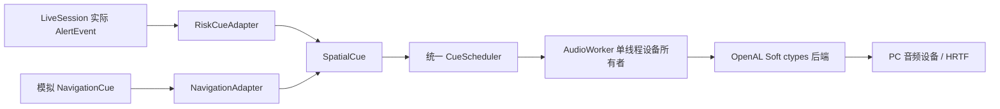

# 空间音频架构

SightGuard 空间音频是视觉风险提醒的可选呈现通道，不参与检测、跟踪、风险评分或决策。实时会话默认关闭空间音频；开启后，LiveSession 已产生的 `AlertEvent` 才会由适配器转换为音频 cue。没有实际风险或感知受限事件时，不因画面持续存在而重复发声。

`RiskCueAdapter` 只读取已生成的首次提醒、风险升级和感知受限提醒，不改变风险规则。方向仅在提醒时间对应的观测、检测索引及事件状态可可靠匹配时取相机水平位置；数据过期、关联不唯一、感知失败或方向不可用时，仍保留有效期内的提醒，但方向回退到听者正前方并标记为不可用。相机视场角只有在操作者可靠配置后才用于方位映射，检测置信度不会被当成方向置信度。

Live 会话和 Lab 共用同一调度器与音频工作线程模型。调度器按优先级和 TTL 选取单个可播放 cue；较高优先级风险/系统 cue 可打断模拟导航音。导航恢复时，在原 TTL 尚有效的前提下从短音开头重播，不尝试 seek 或续播。音频后端上下文只在所属工作线程中创建、使用和释放；多个会话通过设备租约避免同时争用上下文。音频初始化或播放失败只关闭音频通道，不中断视觉处理。

OpenAL Soft 通过 `ctypes` 加载，不要求额外 Python OpenAL 包。运行时请求 `ALC_SOFT_HRTF` 并读取实际 HRTF 状态及数据集；不可用时明确报告状态并降级为普通立体声输出。后端禁用 Doppler，并把方向输入放在固定单位距离上，减少音量随虚拟距离变化。短提示音由本地合成，风险/导航类型以节奏区分，振幅保持保守。

当前 Windows x64 本地运行使用官方 OpenAL Soft 1.25.2 release 中的 `models/openal-soft/soft_oal.dll`。该文件位于 Git 忽略目录，不随仓库提交；授权为 LGPL-2.0-or-later。可通过 `SIGHTGUARD_OPENAL_LIBRARY` 或空间音频配置显式指定库路径。实现和扩展常量依据 [OpenAL Soft 1.25.2](https://github.com/kcat/openal-soft/tree/1.25.2)、其 [HRTF 示例](https://github.com/kcat/openal-soft/blob/1.25.2/examples/alhrtf.c) 及 [扩展定义](https://github.com/kcat/openal-soft/blob/1.25.2/include/AL/alext.h)。

设计上参考了 [Microsoft Soundscape](https://github.com/microsoft/soundscape) 与 [Soundscape Community](https://github.com/soundscape-community/soundscape) 对空间音频、应用逻辑和服务边界的拆分思路；这里只借鉴架构分层，没有复制其代码、资源或依赖，也没有移植地图、路线、地理位置或头部跟踪能力。

P1 已将 LiveSession `AlertEvent` 接入适配器，功能默认关闭。P2 已提供同一 worker 队列中的模拟方位 cue、暂停、恢复和取消。当前没有地图/世界坐标、GPS、真实路线导航或头部跟踪；空间音频仅补充盲杖、导盲犬及用户自身判断，不构成碰撞预测或安全保证。

## 产品网页接入

原有 FastAPI 产品页直接通过 product_live.py 复用 LiveController 与 SpatialLabController，
无需 iframe 或额外端口；原上传分析与回放保留。默认不开音频，手动试听标为测试音。
HTTP-only、SameSite=strict 会话 cookie 区分不同浏览器会话，拒绝跨站 POST。
同浏览器多个标签共享该 cookie；它们属于同一控制会话。
试听与实时开启互相释放同会话设备，后台页/卸载由前端停止，断连由心跳租约兜底。
AudioWorker 另以进程内独占锁避免多个 OpenAL context 混音；独立进程间不共享该锁，
应关闭其他服务的音频会话后再试听。声源固定为单位半径，保留方向而不模拟精确距离。
