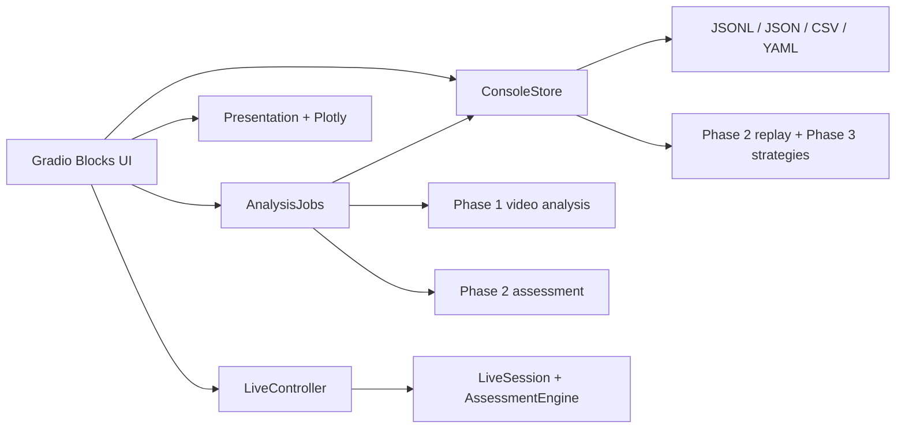

# Research Console 架构

Research Console 是本机研究工具，用于查看已保存的 Phase 1/2 分析、读取 Phase 3
对照实验、浏览数据集，以及在已保存感知记录上预览策略行为。它提供结果浏览和研究操作入口，
不改变风险评分、提醒决策或独立标注口径。
新增第五页实时摄像头 Demo，复用 Phase 5 的 LiveSession；其他研究页面继续使用已保存数据。

## 分层与依赖方向



`ui.app` 负责页面、控件和回调；`ui.services` 将磁盘文件解析为类型明确的 view，进行 schema、
状态、哈希和路径检查；`ui.jobs` 只处理用户明确发起的新视频分析及浏览器媒体副本；
`ui.presentation` 与 `ui.plots` 把已读取的数据转换为表格、说明和图形。风险和策略核心不依赖
Gradio，UI 通过 `FrameRecord`、配置及已保存文件与核心模块交互。

`ui.live` 管理本机摄像头单页面所有权、失败/心跳清理及内存 JPEG；`ui.live_tab` 绑定
开始/停止、Timer 与 tab/unload 清理。实时页不写私人摄像头帧，不向其他浏览器会话提供画面。
展示沿用现有 `render_live(include_panel=False)` 的目标框和关注区域，网页表格直接读取真实
StepResult，未定义值显示 N/A。接口与验证见 [live.md](live.md)。

服务接口的主要数据对象是不可重新计算指标的 `AnalysisView` 和 `BenchmarkView`：

- `AnalysisView` 包含感知记录、可选的 Phase 2 风险帧/事件/提醒、元数据、来源类型、视频时间、
  简单计数与警告。缺少风险产物时保留感知记录，并明确显示风险结果不可用。
- `BenchmarkView` 包含已保存指标、策略提醒、逐提醒匹配、可选报告表、哈希仍有效的真值标签及警告。
  完成状态和产物标记无效的实验不会作为完整 benchmark 展示；指标从 `metrics.json` 读取，UI 不重算。

## 页面与数据流

视觉分析页读取一个现有运行，按请求时间选择最近的先前感知帧，并并列显示其图像、检测与风险观测、
当前提醒、事件生命周期及风险曲线。帧选择基于视频时间戳；信息行同时给出实际帧号和时间，
避免把播放器播放位置误当作数据表定位。

实验对照页按视频、策略和事件筛选已保存的提醒及匹配，时间线将策略输出映射到真值事件而不要求
算法事件 ID 与标注事件 ID 相同。实验分析页展示原始指标、分视频/分场景/严重程度表和错误案例；
缺失数值呈现为 `N/A`，不会替换为 0。数据集页只读展示 manifest 登记、审核状态、来源和文件状态，
并通过 Phase 3 校验入口报告 manifest、输入哈希、审核标记、感知覆盖和来源元数据问题。

策略预览只重放所选 manifest 中的感知 JSONL，并读取用户选定的 benchmark 与 risk YAML 配置。
该预览不会载入 Ground Truth，不产生 TP、FP、FN、召回率或准确性结论。应将其理解为策略行为
检查，而不是一次对照评估。

用户上传本地 MP4 并主动开始分析时，`AnalysisJobs` 创建新运行目录，将上传副本存入该运行，调用
既有 Phase 1 视频流水线写出感知 JSONL，再用 Phase 2 对这份 JSONL 做风险评估。运行时只接受控制台
上传目录中的 MP4，大小上限为 500 MiB；感知配置必须指向项目 `models/` 中已经存在的本地权重，
不会自动下载模型。进度回调来自已处理帧数和视频时间，不代表在线推理延迟。

控制台分析结果把 Phase 1 感知文件放在运行的 `perception/` 子目录，把 Phase 2 产物放在同级
`assessment/` 子目录。读取时，服务只有在 Phase 2 元数据所记感知 JSONL SHA-256 与所选文件一致时，
才会把这组风险帧、事件和提醒并入 `AnalysisView`；缺少或不匹配的评估证据不会被当作该感知运行的结果。

## 文件访问与写入边界

Annotation Studio 是显式人工编辑入口，独立 `annotation_store` 只对已登记且通过
来源校验的 development 标签写入，复用 Schema 3.0。Reviewed/test 只读；保存更新
标签与 manifest 哈希并保留旧版本。它仅显示原始视频和人工区间，不显示模型输出。
原有 ConsoleStore 及其他研究页面继续只读。具体工作流见 [Annotation Studio](annotation_studio.md)。

`ConsoleStore` 的运行 ID、数据集 manifest ID 和配置 ID 都是受限的相对路径。解析后还会检查路径
仍在项目的 `outputs/`、`datasets/` 或 `configs/` 范围内，因此 `..`、绝对路径和逃逸到根目录外的
符号链接会被拒绝。读取标注前，benchmark manifest、标注哈希、感知哈希和运行输入引用必须一致；
变更或无法验证时，真值标签会被省略并附带警告。服务保留历史原始指标，但页面在缺少完整
可验证真值时隐藏汇总准确性指标与错误分类；既有文件不被修改。

已有分析、实验、manifest、标签及配置只读。分析导出在
`outputs/console/exports/` 生成独立 UUID ZIP，并以排他创建方式避免覆盖既有文件。上传视频分析
和浏览器转码只在 `outputs/console/` 下写入新的运行文件或缓存副本；原始研究数据和已完成实验不被改写。

## 本地启动与限制

从项目目录运行：

```powershell
uv run sightguard ui --port 7860
```

服务绑定回环地址 `127.0.0.1`，不启用公开分享链接；Gradio 与 Hugging Face 遥测在导入界面模块时
关闭。页面构建只读取本地文件，不加载 YOLO 权重。实际视频推理仅由上传分析操作触发，并使用本地
权重。全局 Gradio 队列容量为 16；只读页面回调默认并发上限为 2，而所有视觉模型运行共享
`vision-model` 并发组，限制为 1 个同时任务，避免同时启动多个本地模型分析。

本控制台是研究原型，不提供完整导航、路径规划、可靠碰撞预测或安全保证。检测框和画面风险特征
是视觉线索，不能代表真实距离或碰撞概率。合成场景用于验证代码和流程；没有经独立审核的真实视频
标注时，不应把合成指标解释为真实道路表现。更多真值与实验口径见
[Phase 3 方法学](phase3_methodology.md)。
